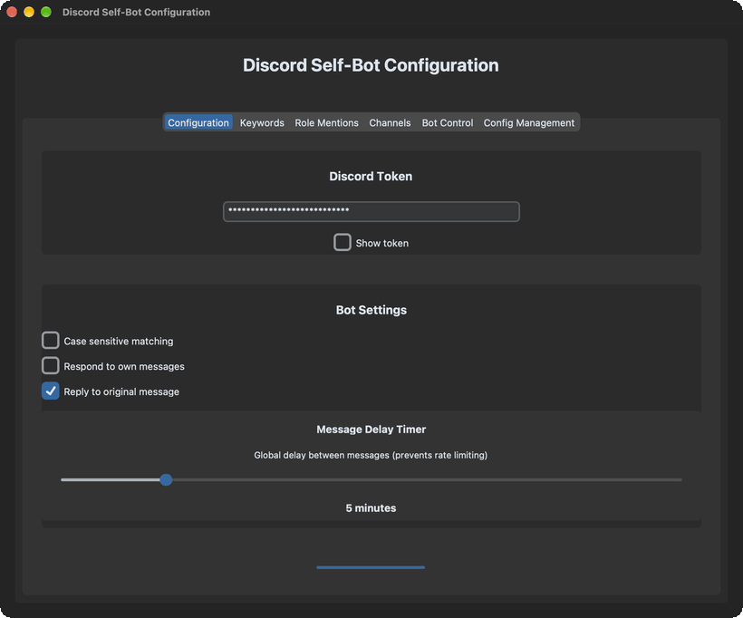

<div align="center">

# Discord Auto-Responder

**TL;DR: auto-reply in Discord the second someone posts a keyword or pings a role.**




</div>

---

I play WoW and wanted to get into boosting (helping other players for gold). The
boosting communities post keys in Discord channels and it's first-come-first-serve.
I kept missing them because by the time I saw the message, someone else had
already claimed it:

| Approach | Problem |
| --- | --- |
| Watching the channel | You can't stare at Discord all day |
| Discord notifications | You still have to see it, open it, and type a reply. Too slow |
| A regular Discord bot | Bots can't reply as you, and the server would have to add it |

So I built this. It watches the channels you pick, and the moment someone posts
one of your keywords or pings one of your roles, it replies for you. Works great
for boosting, but you could use it for anything really.

> [!WARNING]
> This is a **self-bot**: it runs on your personal Discord account, not a bot
> account. That's against Discord's Terms of Service and can get your account
> banned. Use it at your own risk.

## What it does

- **Keyword replies.** Someone says "key" or "boost", it replies with your message instantly.
- **Role pings.** Replies when a specific role gets mentioned, like a "Boosters" role.
- **Only the channels you pick.** So it's not replying all over every server you're in.
- **Cooldown.** Waits a few minutes (5 by default) between replies so you don't spam.
- **Popup when it replies.** A little notification tells you what it replied to and where, so you can DM the person.
- **A GUI for everything.** No editing JSON by hand unless you want to.
- **Multiple configs.** Keep separate setups (say, one per game) and switch between them.

## Setup

1. Install the packages:

   ```sh
   pip install -r requirements.txt
   ```

2. Get your Discord token. Google "how to get Discord token", there are tutorials.
   **Never share it with anyone.** It's basically your password.

3. Run the GUI:

   ```sh
   python gui.py
   ```

4. Set it up:
   - Put your token in the **Configuration** tab
   - Add keywords like "key", "boost", "carry" in **Keywords**, with a reply like "I can do this! DM me"
   - Add the channel IDs where keys get posted in **Channels**
   - Hit **Start Bot** in **Bot Control**

And you're good. Leave it running and it'll grab stuff for you.

## The tabs

| Tab | What it's for |
| --- | --- |
| **Configuration** | Your token, case-sensitive matching, reply vs. new message, and the cooldown slider |
| **Keywords** | Keyword → reply pairs |
| **Role Mentions** | Role ID → reply pairs |
| **Channels** | Which channels it listens in. It shows channel names too, not just IDs |
| **Bot Control** | Start and stop the bot and watch the live logs |
| **Config Management** | Create, copy, and switch between configs |

> [!NOTE]
> After changing settings, restart the bot so it picks them up.

## Configuration

The GUI saves everything to `config.json`, so you don't have to touch it. But if
you want to, here's what it looks like:

```json
{
    "token": "YOUR_USER_TOKEN_HERE",
    "keywords": {
        "key": "I can do this key! DM me",
        "boost": "I'm available for boosting! DM me",
        "carry": "I can carry this! DM me"
    },
    "role_mentions": {
        "123456789012345678": "On it, DM me!"
    },
    "allowed_channels": ["123456789012345678"],
    "case_sensitive": false,
    "respond_to_self": false,
    "reply_to_message": true,
    "message_delay_minutes": 5
}
```

| Option | What it does |
| --- | --- |
| `token` | Your Discord user token |
| `keywords` | Keyword → reply pairs |
| `role_mentions` | Role ID → reply pairs |
| `allowed_channels` | Channel IDs to listen in. Empty means **every** channel, so be careful |
| `case_sensitive` | Whether "Key" and "key" count as different |
| `respond_to_self` | Whether it replies to your own messages |
| `reply_to_message` | `true` replies to the message, `false` sends a new one |
| `message_delay_minutes` | Cooldown between replies. `0` turns it off |

## Getting IDs

Turn on Developer Mode first: **User Settings → Advanced → Developer Mode**.

- **Channel ID:** right-click the channel → Copy ID
- **Role ID:** right-click the role in the member list → Copy ID

## How it works

It's pretty simple:

1. It logs in as you with [discord.py-self](https://github.com/dolfies/discord.py-self).
2. Every message in your allowed channels gets checked for your keywords and role pings.
3. If something matches and the cooldown is up, it replies right away.
4. You get a popup saying where it replied, and you take it from there.

## Troubleshooting

<details>
<summary><b>"Another bot instance is already running"</b></summary>

Only one bot can run at a time. Check if it's running in another terminal. If
it isn't, delete the `bot.lock` file.

</details>

<details>
<summary><b>"Invalid token"</b></summary>

Double check your token, or grab a fresh one. Tokens can stop working when you
log out or change your password.

</details>

<details>
<summary><b>It's not replying</b></summary>

- Is the channel in your allowed channels?
- Are your keywords spelled right? Check the case-sensitive setting too.
- Is the cooldown still running? The logs in **Bot Control** will say so.

</details>

<details>
<summary><b>Errors on Python 3.13+</b></summary>

Install the two modules newer Python removed:

```sh
pip install legacy-cgi audioop-lts
```

</details>
